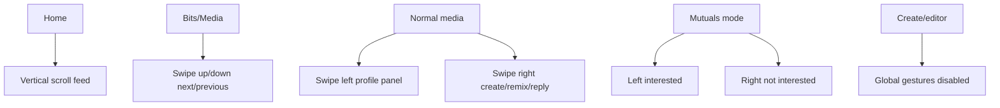

# WeVid V2 Frontend Architecture

Status: accepted
Scope: frontend
Last updated: 2026-11-05
Source of truth: yes

Owns:
- the current route, component, provider, and frontend-state ownership map

Defers to:
- `route-map.md` for public/protected URL semantics
- `landing-page.md` for the public story and entry contract
- OpenAPI, the immutable migration chain, backend services, provider ADRs, and narrow product docs for business truth
- `frontend-release-readiness.md` for release evidence

Does not own:
- unrelated domains, implementation shortcuts, provider secrets, or hidden source-of-truth rules

Launch scope:
- accepted v2 launch or phased behavior stated in this document

Non-goals:
- historical-context inference, duplicate systems, and unapproved provider/product expansion

## Recommendation

Keep Next.js PWA and build the frontend architecture cleanly around:

- route-owned surfaces
- small product components
- generated API client
- TanStack Query for server state
- Zustand/local state for UI state
- Tailwind v4 tokens and component-owned styles
- Playwright visual and flow tests

## Authority And Implementation Status

This is the only current frontend route/component/provider/state ownership map. Narrow documents may
own visual tokens, copy, motion, landing behavior, or release evidence, but they do not redefine this
map:

- `route-map.md` owns canonical URL and access semantics.
- `landing-page.md` owns the semantic poster-first landing and full-page query-state login/onboarding entry.
- `frontend/design-system.md`, `frontend/copy-system.md`, and `frontend/motion-system.md` own only their stated narrow design domains.
- `native-ui-ux-screens.md` is interaction intent; current source paths and tests decide whether an interaction is implemented.
- `frontend/component-map.md` is a reference bridge to this document, not a second inventory.
- `frontend/ui-kit-lock.md` records current shared primitives and shell constraints only.
- `apps/web/public/mockup/design.md` and the mockup images are visual/historical references. Their routes, workflows, copy, provider rules, and implementation instructions are non-authoritative.

“Implemented” below means the named source path exists. It does not imply provider sandbox,
cross-browser, accessibility, or production evidence. Those claims require the release-readiness and
staging records.

## Frontend Boundary

Frontend owns:

- route identity
- source context
- selected media/profile/live/message IDs
- UI sheets/panels/modals
- draft text/forms
- playback controls
- optimistic pending indicators

Frontend does not own:

- payment success
- entitlement/access
- referral commission
- creator earning/tax truth
- provider state
- age/KYC result
- moderation/admin truth

## Route Architecture

```text
apps/web/app/
  page.tsx
  age/page.tsx
  legal/[slug]/page.tsx
  profile/[handle]/page.tsx
  content/[contentId]/page.tsx
  live/[liveRoomId]/page.tsx
  event-access/[eventId]/page.tsx
  mutuals/{page.tsx,feed/page.tsx}
  passes/page.tsx
  performer-consent/{[token]/page.tsx,return/page.tsx}
  oauth/mcp/consent/page.tsx
  offline/page.tsx
  app/
    layout.tsx
    home/page.tsx
    bits/page.tsx
    search/page.tsx
    moments/page.tsx
    create/page.tsx
    messages/page.tsx
    notifications/page.tsx
    activity/page.tsx
    profile/{page.tsx,earnings/page.tsx}
    settings/page.tsx
    subscriptions/page.tsx
    studio/page.tsx
    enterprise/page.tsx
    assistant/page.tsx
    wallet/page.tsx
    live/[liveRoomId]/page.tsx
  admin/{page.tsx,staff/page.tsx,[section]/page.tsx}
```

Routes parse URL state and request canonical projections. `/app/*` is the authenticated shell;
public/contextual routes and the separate admin shell do not become alternate app shells.

## Implemented Ownership Map

- `apps/web/app/layout.tsx` owns root metadata, global styles, and PWA registration. It does not mount wallet, payment, realtime, or identity providers.
- `apps/web/app/app/layout.tsx` owns the authenticated wallet runtime plus Query and Realtime providers; `app-shell.tsx` owns primary and secondary navigation.
- `landing-experience.tsx` owns the public story and full-page login/onboarding state. `landing-wallet-runtime.tsx` scopes wallet runtime to explicit landing authentication intent.
- Contextual content, live, Event Access, profile, consent, and Mutuals pages own their route-local projection and action panels. A contextual action mounts a small local runtime only when its provider is required; it must not create a second provider instance under `/app/*`.
- `src/api-client-read.ts` and the typed API client modules own reads; `src/api-mutations.ts` and `src/api-mutation-transport.ts` own browser mutations and idempotency transport.
- `src/payment-handoff-panel.tsx` owns the shared verified one-time-payment handoff. Product wrappers may supply display context but never settlement or entitlement truth.
- `packages/ui` owns the implemented shared primitives. `apps/web/app/ui.tsx` reexports its listed subset and adds safe error/auth states; consumers import `Button` and `ButtonLink` directly from `@veel/ui`.
- Provider playback stays behind `provider-playback.tsx`; provider payloads and signed resources are never frontend truth.
- `/app/create` exposes exactly **Add photos/videos** and **Go live**. It does not expose text, poll,
  Post/Moment, or Bit/clip/VOD format selectors. Provider-confirmed duration classifies a single
  video as Bit at 60 seconds or less and VOD above 60 seconds; Moments supply their own contextual
  entry without becoming a Create format.
- The private live-host workspace presents browser camera/microphone broadcast as the primary path
  through the official Livepeer React broadcast SDK. OBS remains an explicit advanced path. The
  owner-only recent-auth reveal is the only host credential exception, remains no-store, and is
  kept in component memory for the active workspace only.

## Desktop/Mobile Layout Model

Desktop:

- fixed left rail
- content viewport with route-owned layout
- media viewer locks viewport
- quick chat desktop-only

Mobile:

- bottom nav with five main items
- top actions where needed
- one media card per Home row
- full-screen media viewer
- sheets for comments/share/details/payment
- no desktop dock

## Gesture Model



Gestures must have visible button alternatives.

## UI State Rules

- Server projections: server-component reads through typed clients, or TanStack Query inside the authenticated app provider boundary.
- UI state: local component state or Zustand only.
- Wallet state: wallet adapter/provider state.
- Supabase session state: auth provider.
- Do not duplicate backend state into Zustand.
- Realtime invalidates owned app queries; contextual server routes refresh their canonical projection after a verified mutation.

## Browser-Persisted State Policy

Browser persistence is a UX/recovery aid only. It never authorizes identity, payment, access,
moderation, or provider state. New persisted keys must be added to this inventory with an explicit
scope, data bound, expiry, and cleanup path; private data must fail closed when storage is malformed
or unavailable.

| Data | Storage and scope | Bound and cleanup |
| --- | --- | --- |
| Offline message outbox | `localStorage`, keyed by actor, browser session, and conversation; the browser-session marker is in `sessionStorage` | At most 25 messages per conversation, each expires after 24 hours; current/all-device logout removes the legacy key, all actor queues, and the session marker. |
| Recent searches | `sessionStorage`, keyed by canonical application user ID as `wevid:search:recent:v2:<userId>` | At most six normalized 120-character queries, each expires after 24 hours; actor claim purges the legacy global `localStorage` key and all foreign actor keys, while Clear and both logout paths remove the current/all search state. No actor means no read or write. |
| Creator composition recovery | `localStorage`, keyed by canonical application user ID and ordinary/Moment entry context | Metadata only (draft ID, caption, visibility/safety/representation choices, scheduling, and composition); never media bytes or provider URLs. Removed after submit-for-review; actor scoping prevents another account from restoring it. |
| Embedded-wallet resume choice | `sessionStorage`, one authentication method and login/onboarding purpose | Cleared by completion, cancellation, failure, or the browser session ending; contains no credential or provider token. |
| Performer-consent return | `sessionStorage`, invitation capability for the public provider-return journey | Removed after accept/reject and otherwise ends with the browser session; never copied into account-scoped app state. |
| Onboarding analytics deduplication | `sessionStorage`, random journey UUID plus up to 64 event/occurrence names | Ends with the browser session and contains no wallet, email, handle, content, query, or provider payload. |
| Feed scroll restoration | `sessionStorage`, surface/mode key with numeric scroll offset | Replaced during navigation and ends with the browser session; contains no content IDs or account data. |
| Theme | `localStorage`, browser-wide `light`/`dark` value | Non-account preference retained until the user/browser changes or clears it. |
| PWA shell cache | Cache Storage, versioned public static assets and offline document only | Navigations remain network-first; old `wevid-shell-*` caches are removed on worker activation and authenticated API responses are never cached. |

The canonical application session remains an opaque secure cookie owned by the server. Browser
storage keys are not session, ownership, entitlement, or recent-auth evidence.

## API Client Rules

- No raw `fetch` in UI components.
- All API calls go through generated client or typed domain API module.
- Runtime public env is validated once.
- `NEXT_PUBLIC_*` only for browser-safe values.

## Visual System

- media-first
- dark premium base
- Solana green for active/success/action
- Solana purple for live/moment energy
- no yellow dependency for warning semantics
- icons from one system
- no `!important` growth
- component-owned styles

## Testing

Required v2 tests:

- route/auth gate smoke
- Home desktop/mobile visual
- media viewer desktop/mobile visual
- Create viewport
- payment/content-unlock browser flow
- live host/viewer boundary
- messages realtime
- sourceContext navigation
- no horizontal overflow
- architecture guard

Current implementation state:

- `pnpm smoke` runs Playwright against the Next.js app shell and product routes using its documented local/mock harness.
- The smoke suite runs desktop Chromium and mobile Chromium projects from `tests/smoke`.
- CI installs Chromium and runs the smoke suite after lint, typecheck, and unit tests.
- Mocked browser smoke is not provider sandbox, real-wallet, real-webhook, long-feed, or production deployment evidence.
- Smoke runs are serialized because the authenticated happy-path spec owns a
  temporary local API server on the shared smoke API port.
- `/`, `/age`, `/content/[contentId]`, `/live/[liveRoomId]`, `/profile/[handle]`, `/app/activity`, `/app/messages`, `/app/wallet`, `/app/subscriptions`, `/app/studio`, `/app/bits`, `/event-access/[eventId]`, `/passes`, `/mutuals/feed`, `/mutuals`, `/admin`, and `/app/settings` read backend projections through the typed web API helper instead of local business-data fixtures.
- Settings reads session, age, wallet, feed preference, and notification preference projections from the API; feed/notification preference mutation remains backend-owned through explicit control actions.
- Home and Bits share one typed `FeedExperience` over the canonical chronological server feed. Home presents mixed cards and Bits presents a vertical short-media viewport; both expose Latest/Following tabs, stable `(published_at, id)` cursor loading, route scroll restoration, active-item-only playback, next-poster preload, durable impressions, and canonical optimistic engagement/follow reconciliation. Engagement is display state and never changes ordering.
- Browser Supabase Realtime subscribes only to approved user-owned projection tables and invalidates typed API caches/server component projections. It must not use realtime payloads as payment, access, notification, messaging, or social truth.
- Home/age/detail/profile/activity/messages/wallet/subscriptions/studio/bits/Event Access/Mutuals/admin/settings screens attach the current Supabase access token when present and render a fail-closed unavailable state on API/auth/provider errors.
- Protected app-shell pages use a backend session access guard after Supabase SSR auth. The guard honors `GET /v1/session.appAccessState` and redirects identity, wallet, or age gaps to their remediation routes; it is inert in local projection mode when Supabase browser auth is intentionally unconfigured.
- Content detail renders only backend-issued playback resources: Bunny embed resources use the official Player.js lifecycle API, Livepeer resources use the official React player, and blocked/teaser/not-ready states show access/readiness copy without local entitlement decisions. Qualifying free public VOD/live first renders an explicit Start playback action. That action creates one idempotent backend reservation, then refetches the exact content/live projection; reads and preloads never reserve usage. A provider capability may refresh inside the same active allowance lease without a second reservation, while an expired allowance lease rotates the playback session and idempotency key. Ordered visible-playback heartbeats are analytics-only for the preserved session and never become allowance authority. The unlock panel uses `POST /v1/content/{contentId}/unlock-intents` and the scoped Solana Pay checkout projection; the browser displays the backend-built wallet request only and entitlement remains backend-settlement-owned.
- `/app/subscriptions` presents the five platform tiers separately from profile-specific Creator Memberships. It reads `/v1/platform-access` for current tier and public-media usage, and does not expose provider mint/program/authorization internals as primary consumer UI.
- Create calls `POST /v1/content`, `PATCH /v1/content/{contentId}`, `POST /v1/media/uploads`, `POST /v1/media/assets/{mediaAssetId}/sync`, `GET /v1/content/{contentId}`, and `POST /v1/content/{contentId}/publish` around `tus-js-client` Bunny uploads. Browser state is UX/cache only: metadata save, preview controls, upload completion, provider-sync pending state, and submit-for-review do not approve moderation or create access. Text/poll controls are retired; historical detail renders sanitized text/frozen poll results read-only and never appears in primary feed/discovery/profile grids.
- Live creation reserves the canonical room before opening the host workspace. The workspace derives the browser-broadcast endpoint from the owner-authorized reveal in memory, mounts the official Livepeer broadcast primitives for camera/microphone, and offers OBS only under Advanced setup. It never persists or logs the stream key or ingest URL.
- Current smoke coverage keeps broad projection routes fail-closed when the API
  is unavailable and adds authenticated browser happy-path coverage with a local
  mock API for `landing onboarding -> profile -> wallet -> age -> home -> create -> unlock`.
  The happy path verifies bearer-token attachment and Idempotency-Key behavior
  for create and unlock mutations. Provider staging smoke is still separate and
  required before production readiness.
- `/create` is a mutation-safe launch surface: it describes backend-owned
  draft/upload boundaries without calling mutation APIs on page load or
  rendering fixture record IDs, provider upload URLs, or draft payloads.
- `/assistant` reads `GET /v1/ai/capabilities` and does not create AI sessions,
  execute tools, render AI session IDs, or expose tool-call result payloads on
  page load.
